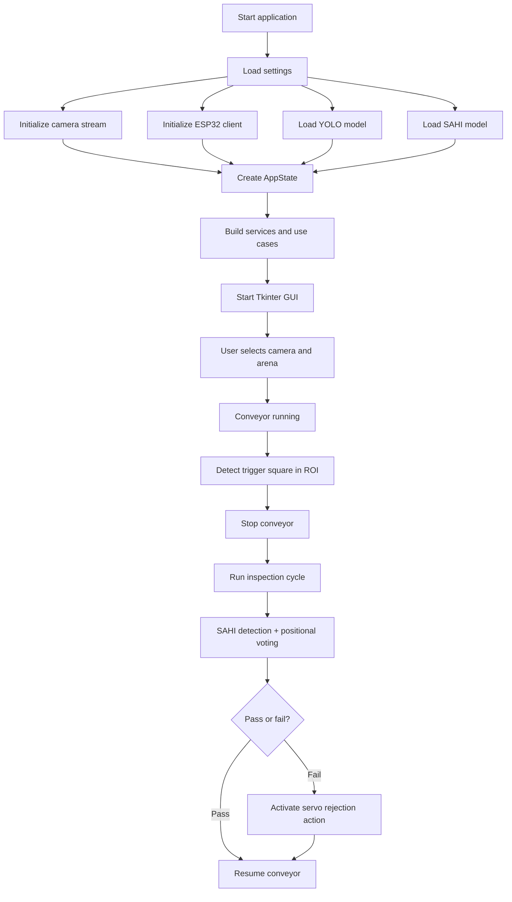

# IoT Smart Belt System

An intelligent conveyor inspection system that combines real-time camera input, object detection, and ESP32-based hardware control to monitor products on a belt and automatically classify correct vs. reject items.

This project is built in Python and uses a Tkinter-based interface for interaction, YOLO/SAHI detection models for visual analysis, and an ESP32 controller for motion and actuator commands.

## Overview

The system is designed for a smart inspection workflow:

- Capture live frames from a camera source.
- Detect a reference marker (for example, a square trigger object) inside a defined ROI/arena.
- Run a small inspection cycle when the marker is found.
- Use a detection model to inspect product positions relative to the marker.
- Evaluate the result with a voting rule.
- Trigger the servo/actuator if a reject item is detected.
- Resume conveyor movement automatically.

This makes the project suitable for automated quality inspection, item verification, and conveyor control in industrial or laboratory environments.

## Key Features

- Real-time camera stream processing
- Tkinter desktop graphical interface
- YOLO and SAHI detection support
- ESP32 motor/servo control integration
- Arena/region selection for inspection zones
- App state management for runtime control flow
- Modular architecture using services, use cases, infrastructure, and domain logic
- Model-based inspection workflow with pass/fail decision logic

## System Architecture

The repository follows a layered design to separate concerns:

- application/: application logic and runtime state
- domain/: business rules and domain entities
- infrastructure/: hardware and model integrations
- presentation/: GUI and controllers
- ultils/: helper utilities and configuration

## Architecture Flow



## Main Components

### 1. Application layer

This layer manages runtime behavior and state transitions.

- application/state/APPstate.py
  - Stores flags for camera status, conveyor status, detection status, and trigger state.
- application/services/camera_service.py
  - Handles camera-related operations.
- application/services/esp32_service.py
  - Starts, stops, and monitors conveyor and ESP32 connectivity.
- application/services/detection_service.py
  - Encapsulates detection-related service logic.
- application/use_cases/conveyor_usecase.py
  - Controls the inspection workflow: trigger detection, inspection cycle, voting, and action execution.

### 2. Domain layer

The domain layer contains the rules used to interpret detection results.

- domain/domain/entities.py
  - Defines product and slot models for inspection results.
- domain/domain/rules.py
  - Implements product validation and positional-voting inspection rules.

The logic is based on detecting a reference square object and evaluating other products relative to it.

### 3. Infrastructure layer

This layer connects the application to external devices and ML components.

- infrastructure/camera/camera_stream.py
  - Manages image acquisition and frame streaming.
- infrastructure/esp32/esp32_client.py
  - Provides communication with the ESP32 client and actuator interfaces.
- infrastructure/yolo/
  - YOLO-based detection pipeline.
- infrastructure/sahi/
  - SAHI detection pipeline for more robust object analysis.
- infrastructure/fasterRCNN/
  - Optional Faster R-CNN integration.

### 4. Presentation layer

The GUI and interaction layer are here.

- presentation/gui.py
  - Main UI window and user interaction controls.
- presentation/controller_camera.py
  - Camera-related controller logic.
- presentation/controller_esp.py
  - ESP32 controller integration.
- presentation/arena_selector.py
  - ROI/arena selection for defining inspection zones.
- presentation/main_controller.py
  - Main entry point for coordinating UI and control modules.

### 5. Utility and configuration

- ultils/config/settings.py
  - Runtime settings for model paths, camera source, ESP32 IP, detection thresholds, and timing.
- ultils/config/constants.py
  - Shared constants for conveyor timing and inspection parameters.

## How the Inspection Workflow Works

1. The application starts and initializes the camera, ESP32 module, and detection models.
2. The GUI begins and allows the user to configure the camera and arena.
3. Conveyor movement begins when the system is activated.
4. The object detection pipeline checks video frames for the trigger square object.
5. Once the trigger square is identified within the selected arena, the conveyor stops.
6. A dedicated inspection cycle runs:
   - detect the square anchor,
   - run a more detailed inspection using SAHI,
   - evaluate product positions relative to the anchor,
   - vote over multiple frames.
7. If the inspection fails, the servo actuator ejects the defective item.
8. The conveyor resumes and the process continues.

## Project Structure

```text
IoT-Smart-Belt-System/
├── application/
│   ├── services/
│   │   ├── camera_service.py
│   │   ├── detection_service.py
│   │   └── esp32_service.py
│   ├── state/
│   │   └── APPstate.py
│   └── use_cases/
│       └── conveyor_usecase.py
├── domain/
│   └── domain/
│       ├── entities.py
│       └── rules.py
├── infrastructure/
│   ├── camera/
│   │   └── camera_stream.py
│   ├── esp32/
│   │   └── esp32_client.py
│   ├── fasterRCNN/
│   ├── sahi/
│   └── yolo/
├── presentation/
│   ├── arena_selector.py
│   ├── controller_camera.py
│   ├── controller_esp.py
│   ├── gui.py
│   └── main_controller.py
├── ultils/
│   ├── config/
│   │   ├── constants.py
│   │   └── settings.py
│   ├── geometry.py
│   └── log.py
├── build.py
├── build.bat
├── main.py
├── main.spec
├── README.md
└── debug.txt
```

## Requirements

The project is primarily Python-based and depends on:

- Python 3.8+
- Tkinter
- OpenCV
- NumPy
- Pillow
- PyTorch and torchvision (for YOLO / Faster R-CNN / SAHI-based model usage)
- SAHI
- pyserial (if serial/ESP32 communication is used)

The repository currently does not contain a complete requirements.txt file, so dependencies should be installed according to the target environment and model backend.

## Configuration

The main runtime settings are stored in:

- ultils/config/settings.py

Important parameters include:

- camera source (`SOURCE_CAMERA`)
- ESP32 IP address (`ESP32_IP`)
- request timeout (`REQUEST_TIMEOUT`)
- model confidence thresholds
- camera capture settings
- conveyor timing and servo delay

Before running the application, verify:

- the camera source is available,
- the ESP32 device is reachable on the configured IP,
- model weights and paths are valid,
- the required packages are installed.

## Running the Project

From the repository root:

```bash
python main.py
```

If you want to package the application:

```bash
pyinstaller main.spec
```

Or use the included helper scripts:

```bash
python build.py
```

On Windows:

```bat
build.bat
```

## Notes on Model Setup

The project uses YOLO and/or SAHI detection pipelines. Depending on the chosen model and environment, the following may be required:

- model weight files,
- model configuration files,
- CUDA-enabled GPU (optional for faster inference),
- correct paths defined in settings.py.

Make sure the required model files are present in the expected directories before running the system.

## Practical Usage

This repository is best suited for a controlled inspection demo or prototype environment where:

- a conveyor is available,
- a camera is mounted above the belt,
- a reference marker is visible in the inspection zone,
- an ESP32 controller is connected to the conveyor and actuator.

## Development Notes

This project is already organized into clear architectural layers, which is a good foundation for future improvements such as:

- adding a dedicated requirements.txt,
- centralizing environment configuration,
- adding automated tests,
- improving logging and diagnostics,
- documenting hardware wiring and model setup,
- adding a proper license file.

## Contributing

Contributions are welcome. For bug reports or feature requests, open an issue and include:

- system configuration,
- camera setup details,
- ESP32 connection status,
- model and dependency versions,
- reproduction steps and expected behavior.

## License

This repository does not currently include an explicit license file. If this project is intended for public use or distribution, consider adding a LICENSE file such as MIT or Apache-2.0.

## Author

LeeDerHerbsjaune

## Summary

The IoT Smart Belt System is a Python-based machine vision and conveyor control project that combines camera detection, model-based inspection, and ESP32 actuation. It is structured around a modular architecture and is well suited for prototype automated product verification and reject handling scenarios.
